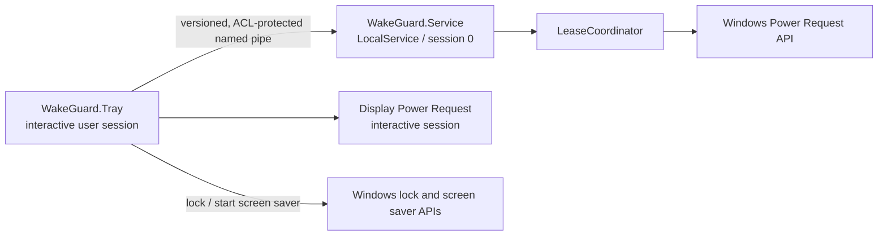

# WakeGuard architecture

## Goals

WakeGuard keeps Windows in the working state after the display turns off or the interactive session is locked. It must never leave a permanent power request behind after its user-facing process crashes or a user signs out.

The application does not simulate input and does not modify the user's sleep, display, lock-screen, lid-close, or battery policies. It uses the documented Windows Power Request API.

## Process model

- `src/WakeGuard.Tauri` builds the native Rust/Tauri `WakeGuard.Tray.exe`, owns interactive-session operations, and never elevates. The old WinForms project is retained as reference and for shared icon assets, but is excluded from the solution and installer build.
- `WakeGuard.Service` owns the machine-wide Power Request and runs as `LocalService`.
- `WakeGuard.Core` contains the platform-independent lease state machine.
- `WakeGuard.Windows` contains Windows API and pipe-security adapters.
- `WakeGuard.Contracts` contains versioned IPC messages and bounded framing.

Per-user preferences are stored under `%LOCALAPPDATA%\WakeGuard`. The tray owns its `HKCU\Software\Microsoft\Windows\CurrentVersion\Run` value, allowing startup to be toggled without elevation. The MSI removes the legacy machine-wide startup value during install or upgrade.

## Lease model

Every tray process creates a random lease identifier and renews it periodically. A lease contains the authenticated Windows user SID, a random client identifier, the requested mode, a short heartbeat deadline, and an optional user-selected stop time.

The service obtains the SID by impersonating the connected pipe client; it never trusts a SID sent in JSON. The effective machine mode is the strongest unexpired lease. Fast User Switching is therefore safe: exiting one user's tray cannot cancel another user's request, and any user's active lease keeps the service running.

If heartbeats stop, the service expires the lease and clears or downgrades its Power Request. The expiry scheduler sleeps until the nearest actual deadline. With no leases or active requests, the service waits through a 30-second quiet period and then stops itself. Windows registers the named pipe as a Service Trigger endpoint, so the next connection starts the demand-start service without granting interactive users service-control permission. A service restart loses its in-memory leases, but a running tray recreates its lease on the next heartbeat. A reboot always starts inactive and does not launch the service until it is needed.

The service uses `PowerRequestSystemRequired` and `PowerRequestExecutionRequired` for every active lease. Windows returns `ERROR_NOT_SUPPORTED` when a Session 0 service attempts `PowerRequestDisplayRequired`, so the interactive tray process owns that request only for display-on mode. The display handle is process-bound and is released automatically if the tray exits or crashes; the service lease still protects system-awake state independently.

## IPC and security

IPC uses one local duplex named pipe. Messages have a four-byte little-endian length prefix and a strict size limit before JSON deserialization. The protocol has an explicit integer version.

The pipe grants full control to `LocalSystem` and `LocalService`, read/write to interactive logon tokens, and no anonymous or network-logon access. Lease ownership is keyed by the pipe client's authenticated SID plus its random client identifier.

## Failure behavior

- Tray crash or forced termination: lease expires after the heartbeat grace period.
- Service crash: Service Control Manager restarts it and the tray recreates its lease.
- Pipe timeout: tray retries and does not claim an unconfirmed mode is active.
- Power API failure: service returns an error and preserves the last confirmed state.
- Timer expiry: service expires the lease even if the tray UI is busy.
- Reboot: no wake mode is restored automatically.

## Packaging

Release builds produce a Rust/Tauri `win-x64` tray executable with embedded HTML/CSS/JavaScript and a .NET 10 Native AOT service. Neither executable carries a managed .NET desktop runtime. The existing WiX MSI installs both executables per machine, registers the service under `LocalService`, and creates required ACLs. The MSI checks for WebView2 Evergreen Runtime instead of bundling a private browser runtime. The non-elevated tray manages startup for the current user according to its saved preference. Binaries are designed for Authenticode signing when a certificate is available.

## On-demand interface

The Tauri application starts with no WebView windows. Rust owns the tray icon, the 20-second lease heartbeat, display power-request handle, settings, and bounded asynchronous pipe client. Both tray mouse buttons open the same local control panel. The frontend is static, has no npm runtime dependencies, and receives only explicit application commands and state events under a restrictive CSP.

The frontend signals readiness after state, language, fonts, and its first layout are complete. Windows remain hidden until that signal. Hiding a panel starts a generation-checked 15-second cleanup; reopening it cancels that cleanup. Destroying WebViews never releases a wake lease, which belongs to the Rust host. A separate hidden Win32 shutdown window keeps MSI close, sign-out, and shutdown handling available even while no WebView exists. Settings retain the previous PascalCase JSON format and user registry startup entry.
